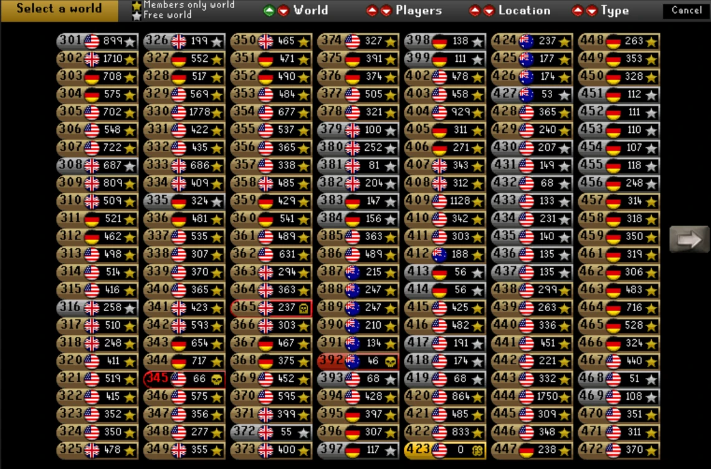

# Old World Select

Brings back the old world select on the login screen: one black screen with a
full-width grid of worlds, the World / Players / Location / Type sort arrows and
a Cancel button, without the side menu of filters.

## Using it

Click the world button in the bottom-left of the login screen as usual.

- Click a world to switch to it.
- Click the red/green arrows in the header to sort.
- If there are more worlds than fit, use the arrows at the left and right edges.
- Hover a world to see its activity.
- Click Cancel or press Escape to go back.

The plugin only acts on the login screen. It works with or without a GPU plugin.

## How it draws

RuneLite overlays only render in game, so the plugin paints into the client's
frame while the world select is open:

- With a GPU plugin enabled, that plugin's draw callbacks are wrapped in a
  pass-through for as long as the world select is open, and restored when it
  closes.
- Without one, the plugin presents the frame itself for as long as the world
  select is open, then hands presentation back to the client.

World data comes from RuneLite's own world service; the plugin makes no network
requests of its own.
